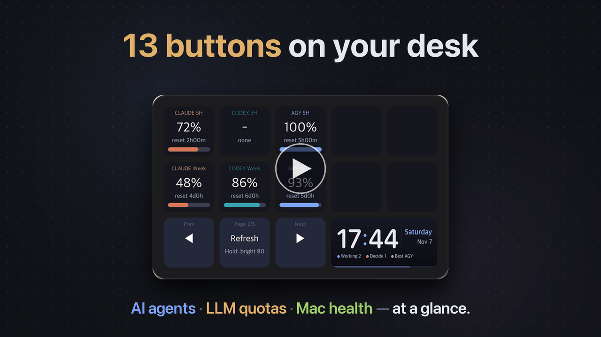
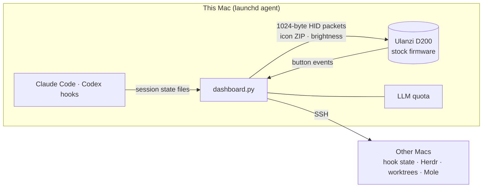

<div align="center">


<p>
  <a href="LICENSE"></a>
  
  
  
  
  <a href="CONTRIBUTING.md"></a>
</p>

**AI agents, LLM quotas and Mac health, on thirteen buttons on your desk.**<br>
A macOS dashboard that drives the Ulanzi D200 directly, without the vendor app

[한국어](README.md) · [日本語](README.ja.md) · [中文](README.zh-CN.md) · [Guide](docs/GUIDE.en.md) · [Features](#-features) · [Quick start](#-quick-start) · [Contributing](#-contributing)

<br>


<a href="docs/video/agentdeck-intro.en.mp4"></a><br>
<sub>▶ 40-second intro video (with sound) — click to watch</sub>

</div>

<br>

## ✨ Who it's for

- You run several agents at once and keep asking **"who's waiting for my approval?"** → Tiles that need a decision **blink yellow**, and pressing one takes you to that window.
- You switch between Claude, Codex and agy and want to know **how much quota is left** → Remaining quota, burn **pace**, and the best LLM to use right now.
- You juggle several Macs → CPU, memory, disk and a health score per Mac, with cleanup one button away.

> 💡 **The firmware is not modified.** The device keeps Ulanzi's stock firmware; agentdeck is **a program on your Mac**. Quit it and open Ulanzi Studio to go back to normal.

## 🛒 What you need

- **Ulanzi Stream Controller D200**: pick **the cheapest or any seller you like** from the [AliExpress search results](https://www.aliexpress.com/w/wholesale-ulanzi-d200.html). There's also the [Ulanzi store](https://www.ulanzi.com/products/stream-deck-d200).
  - ⚠️ Make sure the listing really is the **D200**. The similarly named **D200X** (with knobs) and **D200H** are different models and haven't been tested.
- macOS (Apple Silicon), Python 3.11+

## 🧩 Features

> Step-by-step setup for every feature, with pictures, is in the **[guide](docs/GUIDE.en.md)**.

<table>
<tr>
<td width="50%" valign="top">

### 1 · Remaining LLM quota
**5-hour and weekly quota left** for Claude, Codex and agy (optional: Google Flow · Higgsfield credits), usage **pace** (too fast / on track / ahead), the best LLM right now, next reset

<sub>→ [Guide: LLM quota](docs/GUIDE.en.md#41-remaining-llm-quota-pages-1-2)</sub>

</td>
<td width="50%"></td>
</tr>
<tr>
<td></td>
<td valign="top">

### 3 · Agent activity
Agent status and running count per project
- 🟨 needs decision · 🟩 finished → **blinks**; press to jump to that window
- Collected through hooks wherever agents run: **VS Code, Cursor, iTerm, Ghostty, Terminal**
- [Herdr](https://herdr.dev) users get extras such as zooming lead panes

<sub>→ [Guide: agents](docs/GUIDE.en.md#42-agent-activity-page-3)</sub>

</td>
</tr>
<tr>
<td valign="top">

### Worktrees
git worktrees grouped as **stale, mergeable, old, active**. Hold twice to remove a merged worktree or ask the lead agent to tidy up.

<sub>→ [Guide: worktrees](docs/GUIDE.en.md#43-worktrees)</sub>

</td>
<td></td>
</tr>
<tr>
<td></td>
<td valign="top">

### 4 · Machines and device detail
CPU, memory, disk and external drives across Macs, with the [Mole](https://github.com/tw93/Mole) **health score**. Press a machine for details, where you can **clean caches, purge build artifacts and empty the Trash**.

<sub>→ [Guide: machines](docs/GUIDE.en.md#44-machines-and-device-detail-page-4)</sub>

</td>
</tr>
<tr>
<td valign="top">

### 5 · Pomodoro
Ten cells drain **from the last one backwards**. Blinks and sends a macOS notification when time is up.

<sub>→ [Guide: pomodoro](docs/GUIDE.en.md#45-pomodoro-page-5)</sub>

</td>
<td></td>
</tr>
<tr>
<td></td>
<td valign="top">

### 6 · Korean stock heatmap
Korean stocks coloured by daily change, like [HeatTab](https://heattab.app) (red up, blue down, the Korean convention). Switch between **KOSPI and KOSDAQ top 10, sector movers, your portfolio, watched sectors, and FX, oil, gold and US yields** with the middle button; press a tile to open a HeatTab new tab.

<sub>→ [Guide: heatmap](docs/GUIDE.en.md#46-korean-stock-heatmap-page-6)</sub>

</td>
</tr>
<tr>
<td valign="top">

### 7 · Games
The top ten keys become a game board: **whack-a-mole** (30 s, golden +3, bomb −3), **memory** (repeat the order keys light up in), **pairs** with the aquarium friends, **slots** where you stop each reel yourself, **blackjack** with hit, stand and double, a **poker duel** against the computer, and a **horse race** (win, quinella, exacta and trio bets) run across a track made from the top five keys. Scores and coins are saved.

<sub>→ [Guide: games](docs/GUIDE.en.md#47-games-page-7)</sub>

</td>
<td></td>
</tr>
<tr>
<td></td>
<td valign="top">

### 8 · Chill screensavers
Four whole-deck scenes with matching ambience: **aquarium, fireplace, rainy window and sunset beach**. Fish, pufferfish, jellyfish, crabs, a turtle, an octopus and a shark roam the aquarium; pressing a key drops food, throws a log, calls lightning or sends a big wave. It starts by itself when the deck sits idle and steps aside when an alert comes in.

<sub>→ [Guide: chill screensavers](docs/GUIDE.en.md#48-chill-screensavers-aquarium--fire--rain--beach)</sub>

</td>
</tr>
</table>

## 🚀 Quick start

```bash
git clone https://github.com/jakeparkcolde/agentdeck.git
cd agentdeck
python3 -m venv .venv && .venv/bin/pip install -r requirements.txt
cp config.example.json config.json
.venv/bin/python dashboard.py            # quit Ulanzi Studio first!
```

| Next | Run |
|---|---|
| Start at login | `./scripts/install-launchd.sh` |
| Turn on agent activity (any IDE or terminal) | `python3 scripts/install-hooks.py` |
| Change language | Follows your macOS language by default (Korean → Korean, anything else → English). To pin it, set `"ui_lang": "en"` or `"ko"` in `config.json` |

New to this? Follow the **[guide](docs/GUIDE.en.md)**, from setup through each feature to troubleshooting.

## 🎛 Controls

| Button | Action |
|---|---|
| ◀ / ▶ | Change page |
| Middle: tap / hold | **Home** (shortcuts + what's new) and refresh / cycle brightness |
| Hold the wide tile 2 s | **Update and restart** when a new version is available |
| Blinking tile | Jump to that agent and acknowledge |
| 🔴 Delete / purge | **Hold once to arm (red), then hold again within 10 s** |

## 🔧 How it works



- The 13 key icons (196×196) and the wide tile (458×196) are sent together as **one ZIP**. Icon names are content hashes, so only changed tiles are redrawn.
- The protocol implementation builds on [redphx/strmdck](https://github.com/redphx/strmdck) and [jcalado/companion-surface-d200](https://github.com/jcalado/companion-surface-d200).

> ⚠️ The Codex lookup uses **undocumented internal endpoints**. They may change or stop working at any time. Check the service's terms and use it at your own risk.

agy runs the official read-only CLI command `agy -p /usage --output-format json` over SSH (CLI 1.1.11+). If the login keeps expiring, install the collector on the agy computer once: `.venv/bin/python remote_agy.py --install`. See [Antigravity quota](docs/ANTIGRAVITY.md) for requirements.

## 🗺 Roadmap

- [x] Hook-based agent collection (VS Code · Cursor · terminals)
- [x] Korean / English on-device labels
- [ ] Calendar and to-do page (meeting countdown, check off tasks)
- [ ] PR / CI status page
- [ ] Page plugins (add pages without touching core code)

Have an idea? [Open a feature request](https://github.com/jakeparkcolde/agentdeck/issues/new/choose).

## 🤝 Contributing

New pages, data sources, translations and bug reports are all welcome. **No device needed**: `demo.py` renders every screen from mock data.
See **[CONTRIBUTING.md](CONTRIBUTING.md)**.

## 🙏 Credits

- D200 protocol: [redphx/strmdck](https://github.com/redphx/strmdck) (MIT) · [jcalado/companion-surface-d200](https://github.com/jcalado/companion-surface-d200)
- Mac cleanup: [tw93/Mole](https://github.com/tw93/Mole) · Agent terminals: [Herdr](https://herdr.dev)
- The banner background was generated with OpenAI Codex image generation.

agentdeck is an unofficial project, not affiliated with Ulanzi, Anthropic, OpenAI or Google.

## 📄 License

[MIT](LICENSE)
