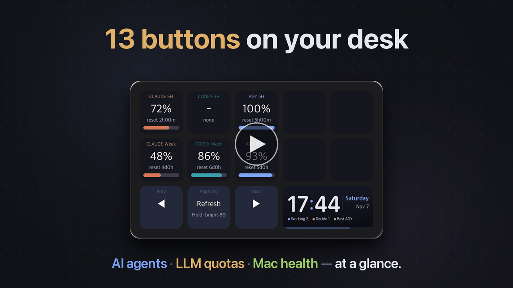
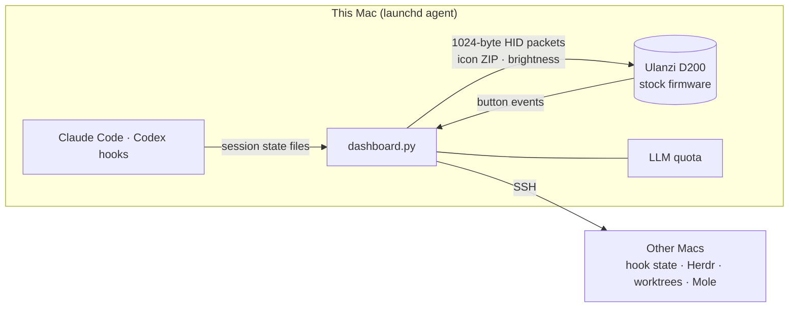

<div align="center">


<p>
  <a href="LICENSE"></a>
  
  
  
  
  <a href="CONTRIBUTING.md"></a>
</p>

**AI エージェント、LLM の残り使用枠、Mac の状態を、デスクの13個のボタンに。**<br>
ベンダーアプリを使わずに Ulanzi D200 を直接動かす macOS ダッシュボード

[English](README.en.md) · [한국어](README.md) · [中文](README.zh-CN.md) · [ガイド (英語)](docs/GUIDE.en.md) · [機能](#-機能) · [クイックスタート](#-クイックスタート) · [コントリビュート](#-コントリビュート)

<br>


<a href="docs/video/agentdeck-intro.en.mp4"></a><br>
<sub>▶ 40秒の紹介動画（英語・音声あり）— クリックで再生</sub>

</div>

<br>

## ✨ 対象ユーザー

- 複数のエージェントを同時に動かしていて、「**承認待ちはどれ？**」と何度も確認してしまう → 判断が必要なタイルが**黄色く点滅**し、押すとそのウィンドウに移動します。
- Claude・Codex・agy を使い分けていて、**残りの使用枠がどれくらいか**を知りたい → 残量、消費**ペース**、そして今使うのに最適な LLM がわかります。
- 複数の Mac を使い分けている → Mac ごとに CPU・メモリ・ディスクとヘルススコアを表示し、ボタンひとつでクリーンアップできます。

> 💡 **ファームウェアは改造しません。** デバイスは Ulanzi 純正のファームウェアのままで、agentdeck は **Mac 上で動くプログラム**です。終了して Ulanzi Studio を開けば、いつもどおりに戻ります。

## 🛒 必要なもの

- **Ulanzi Stream Controller D200**：[AliExpress の検索結果](https://www.aliexpress.com/w/wholesale-ulanzi-d200.html)から、**最安値の店でも好きな販売店でも**お選びください。[Ulanzi 公式ストア](https://www.ulanzi.com/products/stream-deck-d200)もあります。
  - ⚠️ 商品が本当に **D200** かどうか確認してください。名前の似た **D200X**（ノブ付き）や **D200H** は別モデルで、動作確認していません。
- macOS（Apple Silicon）、Python 3.11+

## 🧩 機能

> すべての機能の設定手順を、画像付きで **[ガイド](docs/GUIDE.en.md)** にまとめています。

<table>
<tr>
<td width="50%" valign="top">

### 1 · LLM の残り使用枠
Claude・Codex・agy の **5時間枠と週間枠の残量**（オプション：Google Flow・Higgsfield のクレジット）、使用**ペース**（速すぎ / 順調 / 余裕あり）、今最適な LLM、次のリセット

<sub>→ [ガイド：LLM の残り使用枠](docs/GUIDE.en.md#41-remaining-llm-quota-pages-1-2)</sub>

</td>
<td width="50%"></td>
</tr>
<tr>
<td></td>
<td valign="top">

### 3 · エージェントの稼働状況
プロジェクトごとのエージェントの状態と実行数
- 🟨 判断待ち · 🟩 完了 → **点滅**します。押すとそのウィンドウへジャンプ
- エージェントがどこで動いていてもフックで収集：**VS Code, Cursor, iTerm, Ghostty, Terminal**
- [Herdr](https://herdr.dev) ユーザーは、リードペインのズームなどの追加機能も使えます

<sub>→ [ガイド：エージェント](docs/GUIDE.en.md#42-agent-activity-page-3)</sub>

</td>
</tr>
<tr>
<td valign="top">

### ワークツリー
git worktree を **停滞・マージ可能・古い・アクティブ** に分類します。2回長押しで、マージ済みのワークツリーを削除したり、リードエージェントに整理を頼んだりできます。

<sub>→ [ガイド：ワークツリー](docs/GUIDE.en.md#43-worktrees)</sub>

</td>
<td></td>
</tr>
<tr>
<td></td>
<td valign="top">

### 4 · マシンとデバイス詳細
複数の Mac の CPU・メモリ・ディスク・外付けドライブと、[Mole](https://github.com/tw93/Mole) の**ヘルススコア**を表示します。マシンを押すと詳細画面が開き、**キャッシュの削除、ビルド成果物の一掃、ゴミ箱を空にする**操作ができます。

<sub>→ [ガイド：マシン](docs/GUIDE.en.md#44-machines-and-device-detail-page-4)</sub>

</td>
</tr>
<tr>
<td valign="top">

### 5 · ポモドーロ
10個のセルが**最後のセルから順に**減っていきます。時間になると点滅し、macOS の通知を送ります。

**プレゼンモード**（ホーム → 発表）：スライド ◀ ▶（Keynote・PowerPoint・PDF・Google スライド）、目標時間タイマー（残り5分で黄、超過で赤）、画面ブラックアウト、講義録音 → [agentnote](https://github.com/jakeparkcolde/agentnote) で講義ノート、★重要・Q質問の時点マーク、デモのショートカット（`config.json` の `presentation.demos`）。初回はアクセシビリティとマイクの許可を求められます。

<sub>→ [ガイド：ポモドーロ](docs/GUIDE.en.md#45-pomodoro-page-5)</sub>

</td>
<td></td>
</tr>
<tr>
<td></td>
<td valign="top">

### 6 · 韓国株ヒートマップ
[HeatTab](https://heattab.app) のように、韓国株を日次の騰落率で色分けします（韓国の慣習どおり、赤が上昇・青が下落）。中央ボタンで **KOSPI・KOSDAQ の上位10銘柄、セクター別の値動き、ポートフォリオ、ウォッチ中のセクター、為替・原油・金・米国債利回り** を切り替えられます。タイルを押すと HeatTab を新しいタブで開きます。

<sub>→ [ガイド：ヒートマップ](docs/GUIDE.en.md#46-korean-stock-heatmap-page-6)</sub>

</td>
</tr>
<tr>
<td valign="top">

### 7 · ゲーム
上段の10キーがゲーム盤になります。**モグラたたき**（30秒、金色 +3、爆弾 −3）、**記憶ゲーム**（キーが光った順番を再現）、水族館の仲間たちとの**神経衰弱**、リールを自分で止める**スロット**、ヒット・スタンド・ダブルができる**ブラックジャック**、コンピューターと対戦する**ポーカー対決**、そして上段5キーで作ったトラックを走る**競馬**（単勝・馬連・馬単・3連複）。スコアとコインは保存されます。

<sub>→ [ガイド：ゲーム](docs/GUIDE.en.md#47-games-page-7)</sub>

</td>
<td></td>
</tr>
<tr>
<td></td>
<td valign="top">

### 8 · 癒やしのスクリーンセーバー
デッキ全体を使った4つのシーンと、それぞれに合った環境音：**水族館、暖炉、雨の窓辺、夕日のビーチ**。水族館では魚、フグ、クラゲ、カニ、カメ、タコ、サメが泳ぎ回ります。キーを押すと、エサを落としたり、薪をくべたり、雷を呼んだり、大波を起こしたりします。デッキがしばらく操作されないと自動で始まり、通知が来ると表示を譲ります。

<sub>→ [ガイド：癒やしのスクリーンセーバー](docs/GUIDE.en.md#48-chill-screensavers-aquarium--fire--rain--beach)</sub>

</td>
</tr>
</table>

## 🚀 クイックスタート

```bash
git clone https://github.com/jakeparkcolde/agentdeck.git
cd agentdeck
python3 -m venv .venv && .venv/bin/pip install -r requirements.txt
cp config.example.json config.json
.venv/bin/python dashboard.py            # quit Ulanzi Studio first!
```

| 次のステップ | 実行 |
|---|---|
| ログイン時に自動起動 | `./scripts/install-launchd.sh` |
| エージェントの稼働状況を有効化（どの IDE・ターミナルでも可） | `python3 scripts/install-hooks.py` |
| 言語の変更 | デフォルトでは macOS の言語に従います（韓国語 → 韓国語、それ以外 → 英語）。固定するには `config.json` で `"ui_lang": "en"` または `"ko"` を設定してください |

はじめての方は、セットアップから各機能、トラブルシューティングまでをまとめた **[ガイド](docs/GUIDE.en.md)** をご覧ください。

## 🎛 操作方法

| ボタン | 動作 |
|---|---|
| ◀ / ▶ | ページ切り替え |
| 中央：タップ / 長押し | **ホーム**（ショートカット + 新着情報）と、更新 / 明るさの切り替え |
| ワイドタイルを2秒長押し | 新しいバージョンがあるときに **アップデートして再起動** |
| 点滅中のタイル | そのエージェントへジャンプして確認済みにする |
| 🔴 削除 / 一掃 | **1回長押しで待機状態（赤）にし、10秒以内にもう一度長押し** |

## 🔧 仕組み



- 13個のキーアイコン（196×196）とワイドタイル（458×196）は、**1つの ZIP** にまとめて送信します。アイコン名はコンテンツハッシュなので、変更されたタイルだけが再描画されます。
- プロトコルの実装は [redphx/strmdck](https://github.com/redphx/strmdck) と [jcalado/companion-surface-d200](https://github.com/jcalado/companion-surface-d200) をベースにしています。

> ⚠️ Codex の取得には**非公開の内部エンドポイント**を使っています。いつ変更・停止されてもおかしくありません。サービスの利用規約を確認のうえ、自己責任でご利用ください。

agy は公式の読み取り専用 CLI コマンド `agy -p /usage --output-format json` を SSH 経由で実行します（CLI 1.1.11+）。ログインが頻繁に切れる場合は、agy のコンピューターに収集ジョブを一度インストールしてください: `.venv/bin/python remote_agy.py --install`。要件は [Antigravity の使用枠](docs/ANTIGRAVITY.md) をご覧ください。

## 🗺 ロードマップ

- [x] フックによるエージェント収集（VS Code · Cursor · ターミナル）
- [x] デバイス上のラベルの韓国語 / 英語対応
- [ ] カレンダーと ToDo ページ（会議までのカウントダウン、タスクのチェック）
- [ ] PR / CI ステータスページ
- [ ] ページプラグイン（コアのコードに触れずにページを追加）

アイデアがあれば、[機能リクエストを作成](https://github.com/jakeparkcolde/agentdeck/issues/new/choose)してください。

## 🤝 コントリビュート

新しいページ、データソース、翻訳、バグ報告、どれも大歓迎です。**デバイスは不要です**：`demo.py` がモックデータですべての画面を描画します。
詳しくは **[CONTRIBUTING.md](CONTRIBUTING.md)** をご覧ください。

## 🙏 クレジット

- D200 プロトコル：[redphx/strmdck](https://github.com/redphx/strmdck)（MIT）· [jcalado/companion-surface-d200](https://github.com/jcalado/companion-surface-d200)
- Mac のクリーンアップ：[tw93/Mole](https://github.com/tw93/Mole) · エージェント用ターミナル：[Herdr](https://herdr.dev)
- バナーの背景は OpenAI Codex の画像生成で作成しました。

agentdeck は非公式プロジェクトであり、Ulanzi、Anthropic、OpenAI、Google とは提携していません。

## 📄 ライセンス

[MIT](LICENSE)
