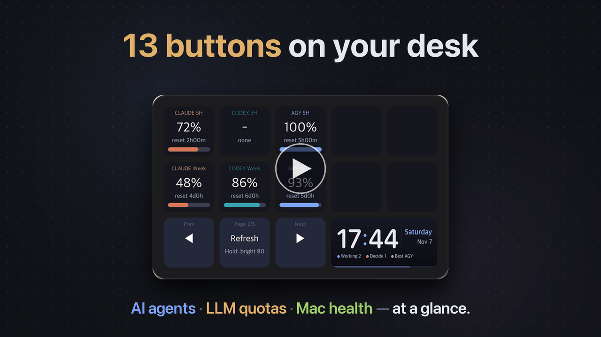
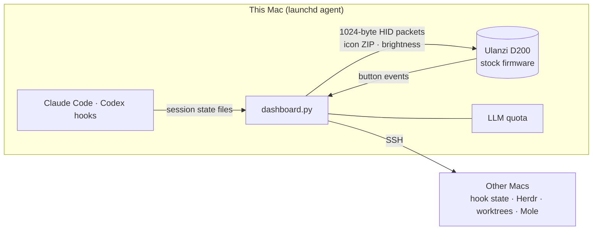

<div align="center">


<p>
  <a href="LICENSE"></a>
  
  
  
  
  <a href="CONTRIBUTING.md"></a>
</p>

**AI 智能体、LLM 额度和 Mac 健康状态，尽在桌上的十三个按键。**<br>
一款 macOS 仪表盘，无需厂商应用，直接驱动 Ulanzi（优篮子）D200

[English](README.en.md) · [한국어](README.md) · [日本語](README.ja.md) · [使用指南（英文）](docs/GUIDE.en.md) · [功能](#-功能) · [快速开始](#-快速开始) · [参与贡献](#-参与贡献)

<br>


<a href="docs/video/agentdeck-intro.en.mp4"></a><br>
<sub>▶ 40 秒介绍视频（英文，有声音）— 点击观看</sub>

</div>

<br>

## ✨ 适合谁

- 同时跑好几个智能体，总在问 **"谁在等我审批？"** → 需要你决定的磁贴会 **闪黄色**，按一下就跳到对应窗口。
- 在 Claude、Codex 和 agy 之间来回切换，想知道 **还剩多少额度** → 显示剩余额度、消耗 **速度**，以及当下最适合用的 LLM。
- 手上有好几台 Mac → 每台 Mac 的 CPU、内存、磁盘和健康评分一目了然，一键即可清理。

> 💡 **固件没有被修改。** 设备保留 Ulanzi 原厂固件；agentdeck 只是 **运行在你 Mac 上的一个程序**。退出它、打开 Ulanzi Studio，就能恢复原样。

## 🛒 准备工作

- **Ulanzi Stream Controller D200**：在 [AliExpress 搜索结果](https://www.aliexpress.com/w/wholesale-ulanzi-d200.html) 里 **挑最便宜的或你喜欢的卖家** 即可。也可以去 [Ulanzi 官方商店](https://www.ulanzi.com/products/stream-deck-d200)。
  - ⚠️ 请确认商品确实是 **D200**。名字相近的 **D200X**（带旋钮）和 **D200H** 是不同型号，尚未测试。
- macOS（Apple Silicon）、Python 3.11+

## 🧩 功能

> 每项功能的分步设置（附图）请看 **[使用指南](docs/GUIDE.en.md)**。

<table>
<tr>
<td width="50%" valign="top">

### 1 · LLM 剩余额度
Claude、Codex 和 agy 的 **5 小时与每周剩余额度**（可选：Google Flow · Higgsfield 积分）、使用 **速度**（过快 / 正常 / 有余量）、当下最佳 LLM、下次重置时间

<sub>→ [指南：LLM 额度](docs/GUIDE.en.md#41-remaining-llm-quota-pages-1-2)</sub>

</td>
<td width="50%"></td>
</tr>
<tr>
<td></td>
<td valign="top">

### 3 · 智能体活动
按项目显示智能体状态和运行数量
- 🟨 待决定 · 🟩 已完成 → **闪烁**；按下即跳到对应窗口
- 无论智能体在哪里运行，都通过 hook 收集：**VS Code、Cursor、iTerm、Ghostty、终端**
- [Herdr](https://herdr.dev) 用户还能用上放大主窗格等额外功能

<sub>→ [指南：智能体](docs/GUIDE.en.md#42-agent-activity-page-3)</sub>

</td>
</tr>
<tr>
<td valign="top">

### 工作树
git worktree 按 **已失效、可合并、较旧、活跃** 分组。长按两次即可删除已合并的工作树，或让主智能体帮忙整理。

<sub>→ [指南：工作树](docs/GUIDE.en.md#43-worktrees)</sub>

</td>
<td></td>
</tr>
<tr>
<td></td>
<td valign="top">

### 4 · 设备与设备详情
多台 Mac 的 CPU、内存、磁盘和外接硬盘，外加 [Mole](https://github.com/tw93/Mole) 的 **健康评分**。按下某台设备查看详情，可在其中 **清理缓存、清除构建产物、清空废纸篓**。

<sub>→ [指南：设备](docs/GUIDE.en.md#44-machines-and-device-detail-page-4)</sub>

</td>
</tr>
<tr>
<td valign="top">

### 5 · 番茄钟
十个格子 **从最后一格开始倒着** 消减。时间到时闪烁并发送 macOS 通知。

<sub>→ [指南：番茄钟](docs/GUIDE.en.md#45-pomodoro-page-5)</sub>

</td>
<td></td>
</tr>
<tr>
<td></td>
<td valign="top">

### 6 · 韩国股市热力图
仿照 [HeatTab](https://heattab.app)，按当日涨跌给韩国股票上色（红涨蓝跌，韩国惯例）。用中间按键在 **KOSPI 与 KOSDAQ 前 10、板块异动、你的持仓、关注板块，以及汇率、原油、黄金和美债收益率** 之间切换；按下磁贴即可在新标签页打开 HeatTab。

<sub>→ [指南：热力图](docs/GUIDE.en.md#46-korean-stock-heatmap-page-6)</sub>

</td>
</tr>
<tr>
<td valign="top">

### 7 · 小游戏
上方十个按键变成游戏面板：**打地鼠**（30 秒，金色 +3，炸弹 −3）、**记忆**（按按键亮起的顺序重复）、和水族箱小伙伴一起玩 **翻牌配对**、每个转轮由你亲手停下的 **老虎机**、可以要牌、停牌和加倍的 **21 点**、与电脑对战的 **扑克对决**，以及在上方五个按键组成的赛道上进行的 **赛马**（可押独赢、连赢、正序连赢和三重彩）。分数和金币都会保存。

<sub>→ [指南：小游戏](docs/GUIDE.en.md#47-games-page-7)</sub>

</td>
<td></td>
</tr>
<tr>
<td></td>
<td valign="top">

### 8 · 放松屏保
四个铺满整块面板的场景，配有相应的环境音：**水族箱、壁炉、雨窗和日落海滩**。水族箱里有鱼、河豚、水母、螃蟹、一只海龟、一只章鱼和一条鲨鱼游来游去；按下按键可以投喂食物、添一根柴、召唤闪电或掀起大浪。面板闲置时会自动启动，有提醒进来时会自动让开。

<sub>→ [指南：放松屏保](docs/GUIDE.en.md#48-chill-screensavers-aquarium--fire--rain--beach)</sub>

</td>
</tr>
</table>

## 🚀 快速开始

```bash
git clone https://github.com/jakeparkcolde/agentdeck.git
cd agentdeck
python3 -m venv .venv && .venv/bin/pip install -r requirements.txt
cp config.example.json config.json
.venv/bin/python dashboard.py            # quit Ulanzi Studio first!
```

| 下一步 | 运行 |
|---|---|
| 开机自动启动 | `./scripts/install-launchd.sh` |
| 开启智能体活动（任意 IDE 或终端） | `python3 scripts/install-hooks.py` |
| 切换语言 | 默认跟随 macOS 语言（韩语 → 韩语，其他 → 英语）。如需固定，在 `config.json` 中设置 `"ui_lang": "en"` 或 `"ko"` |

第一次上手？跟着 **[使用指南](docs/GUIDE.en.md)** 走，从安装到各项功能再到故障排查都有。

## 🎛 操作方式

| 按键 | 操作 |
|---|---|
| ◀ / ▶ | 翻页 |
| 中间键：短按 / 长按 | **主页**（快捷方式 + 新功能）以及刷新 / 循环切换亮度 |
| 长按宽磁贴 2 秒 | 有新版本时 **更新并重启** |
| 闪烁的磁贴 | 跳到对应智能体并确认 |
| 🔴 删除 / 清除 | **先长按一次进入待确认状态（变红），再在 10 秒内长按一次** |

## 🔧 工作原理



- 13 个按键图标（196×196）和宽磁贴（458×196）打包成 **一个 ZIP** 一起发送。图标以内容哈希命名，因此只重绘有变化的磁贴。
- 协议实现基于 [redphx/strmdck](https://github.com/redphx/strmdck) 和 [jcalado/companion-surface-d200](https://github.com/jcalado/companion-surface-d200)。

> ⚠️ Codex 额度查询使用的是 **未公开的内部接口**，随时可能变更或失效。请查阅该服务的条款，风险自负。

agy 通过 SSH 运行官方只读 CLI 命令 `agy -p /usage --output-format json`（CLI 1.1.11+）。相关要求请见 [Antigravity 额度](docs/ANTIGRAVITY.md)。

## 🗺 路线图

- [x] 基于 hook 的智能体收集（VS Code · Cursor · 终端）
- [x] 设备上的韩语 / 英语标签
- [ ] 日历与待办页面（会议倒计时、勾选任务）
- [ ] PR / CI 状态页面
- [ ] 页面插件（无需改动核心代码即可添加页面）

有想法？[提交功能请求](https://github.com/jakeparkcolde/agentdeck/issues/new/choose)。

## 🤝 参与贡献

欢迎贡献新页面、数据源、翻译和 bug 报告。**不需要设备**：`demo.py` 可以用模拟数据渲染所有画面。
详见 **[CONTRIBUTING.md](CONTRIBUTING.md)**。

## 🙏 致谢

- D200 协议：[redphx/strmdck](https://github.com/redphx/strmdck)（MIT）· [jcalado/companion-surface-d200](https://github.com/jcalado/companion-surface-d200)
- Mac 清理：[tw93/Mole](https://github.com/tw93/Mole) · 智能体终端：[Herdr](https://herdr.dev)
- 横幅背景图由 OpenAI Codex 图像生成功能生成。

agentdeck 是非官方项目，与 Ulanzi、Anthropic、OpenAI 或 Google 均无关联。

## 📄 许可证

[MIT](LICENSE)
